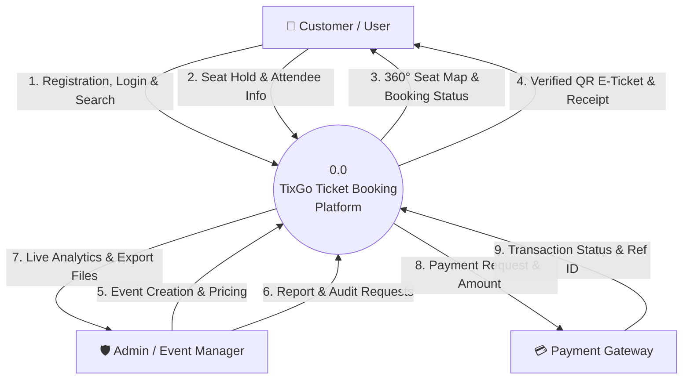
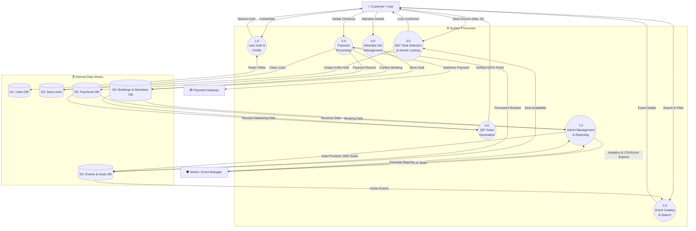

# TixGo — Data Flow Diagrams (DFD) Level 0 & Level 1

---

## 1. DFD Level 0 — Context Diagram

The **Level 0 Context Diagram** represents the entire **TixGo Ticket Booking Platform** as a single high-level central process (`0.0`), identifying the key external entities that interact with the platform and the primary data flows exchanged between them.

### 1.1 External Entities
- **Customer / User**: Interacts with the platform to register accounts, explore cricket matches/concerts, select seats, provide attendee details, complete payments, and download QR e-tickets.
- **Admin / Event Manager**: Oversees event lifecycle management, provisions 2,500-seat stadium configurations, audits real-time bookings, and exports financial revenue reports.
- **Payment Gateway / Banking API**: Receives payment authorization requests, validates transactions, and returns payment status confirmations.

### 1.2 Data Flow Summary Table

| Entity | Inbound Data Flow (To System) | Outbound Data Flow (From System) |
| :--- | :--- | :--- |
| **Customer / User** | • Account Registration & Login Credentials • Event Search & Category Filters • Seat Selections & Hold Requests • Attendee Details & Payment Submission | • Profile Access & Session Authentication • Live Event Catalog & 360° Seat Availability • Seat Hold Confirmation & Expiration Timer • Verified QR E-Tickets & Tax Invoices |
| **Admin / Event Manager** | • Event Creation & Pricing Specifications • Stadium Capacity Parameters • Booking Status Inquiries & Cancellation Actions | • Real-Time Occupancy & Sales Dashboard • Booking Ledgers & Attendee Lists • CSV / Excel Financial Audit Exports |
| **Payment Gateway** | • Payment Authorization & Settlement Response • Transaction Reference ID | • Payment Request & Order Amount • Customer Billing Credentials |

### 1.3 Context Architecture (Mermaid Flow)

---

## 2. DFD Level 1 — Detailed System Decomposition

The **Level 1 Data Flow Diagram** decomposes the central TixGo process into seven core functional sub-processes (`1.0` through `7.0`) and maps data exchanges across five internal data stores (`D1` through `D5`).

### 2.1 Core Sub-Processes

1. **Process 1.0 — User Authentication & Profile Management**
   - Validates user sign-up, sign-in, and password reset requests.
   - Reads/writes user credentials to **D1 (Users DB)**.
2. **Process 2.0 — Event Browsing & Search Engine**
   - Handles multi-category filtering (Cricket, Concerts, Comedy) and keyword searches.
   - Reads active events and venue pricing from **D2 (Events & Seats DB)**.
3. **Process 3.0 — 360° Seat Selection & Atomic Locking**
   - Manages interactive 360-degree stadium visualization (10 stands, Lower @ ₹2,000 / Upper @ ₹1,350).
   - Enforces the 10-ticket purchase limit and writes 5-minute atomic holds to **D3 (Seat Locks)**.
4. **Process 4.0 — Attendee Information Management**
   - Collects full names and contact numbers for every individual seat.
   - Prepares booking records and writes to **D4 (Bookings & Attendees DB)**.
5. **Process 5.0 — Payment Processing & Order Finalization**
   - Transmits payment requests to the external Payment Gateway.
   - On successful settlement, updates booking status to Confirmed and writes to **D5 (Payments DB)**.
   - Releases ephemeral seat locks in **D3** and permanently updates seat status to Booked in **D2**.
6. **Process 6.0 — QR E-Ticket & Invoice Generation**
   - Reads confirmed booking data from **D4** and payment tokens from **D5**.
   - Generates cryptographic QR codes and formatted e-ticket boarding passes for download/print.
7. **Process 7.0 — Admin Management & Reporting Engine**
   - Provisions new events and automatically generates 2,500 stadium seat grids in **D2**.
   - Queries **D1**, **D4**, and **D5** to render revenue dashboards and stream CSV/Excel report exports.

### 2.2 Internal Data Stores (Data Store Dictionary)

| Data Store ID | Data Store Name | Description & Key Attributes |
| :--- | :--- | :--- |
| **D1** | **Users DB** | User ID, Full Name, Email, Phone, Salted Password Hash, Account Status, Timestamps. |
| **D2** | **Events & Seats DB** | Event Metadata, 360° Stand Name, Tier (Lower/Upper), Row, Seat Number, Base Price, Status (Available/Booked). |
| **D3** | **Seat Locks** | Lock ID, Seat ID, User/Session ID, Hold Timestamp, Expiration Timestamp (300s window). |
| **D4** | **Bookings & Attendees DB** | Booking Reference, User ID, Event ID, Total Amount, GST Breakdown, Attendee Names, Phone Numbers, QR Token. |
| **D5** | **Payments DB** | Payment ID, Booking ID, Gateway Reference ID, Payment Method, Amount, Status (Success/Refunded). |

### 2.3 Detailed Process Flow Architecture (Mermaid)

